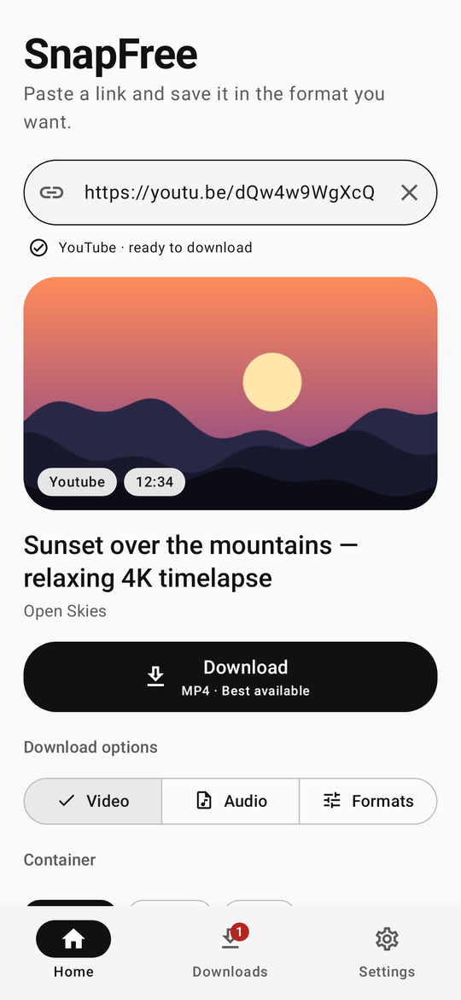
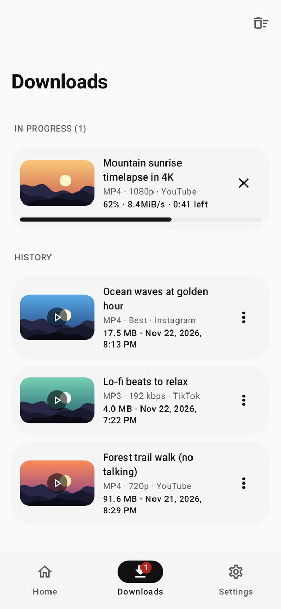
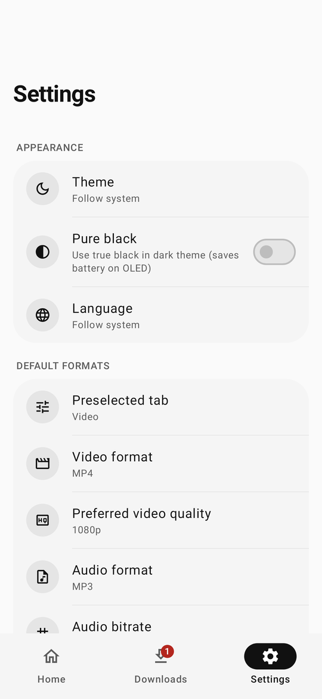
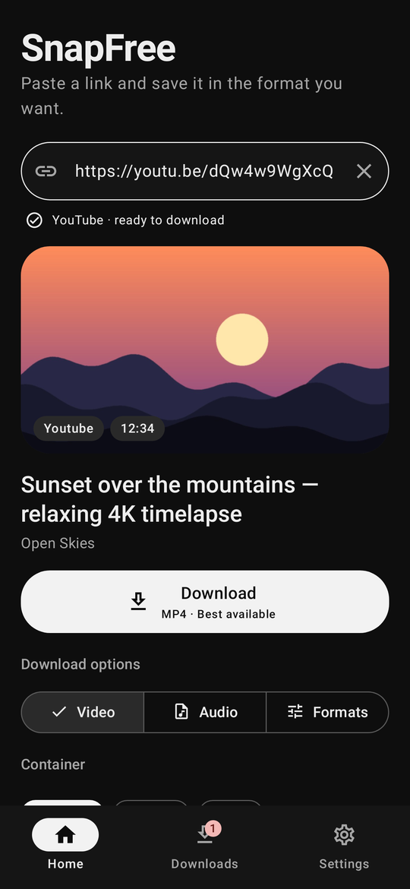
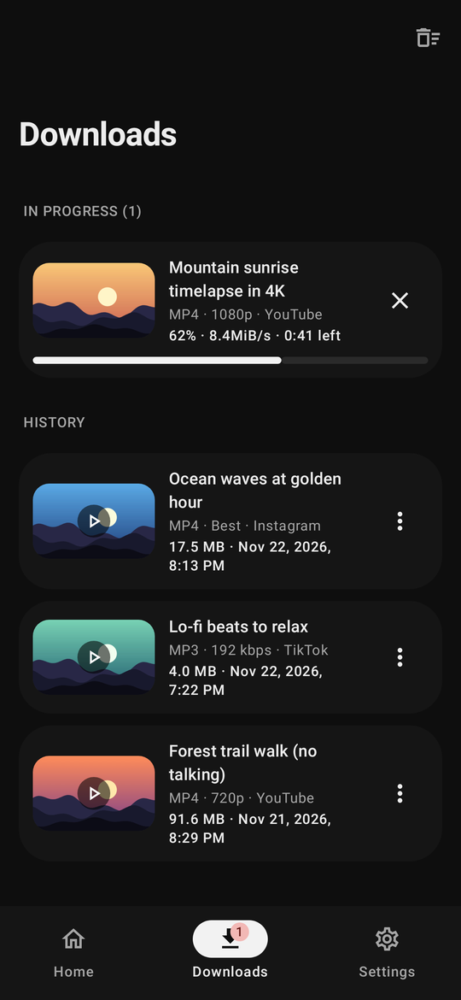
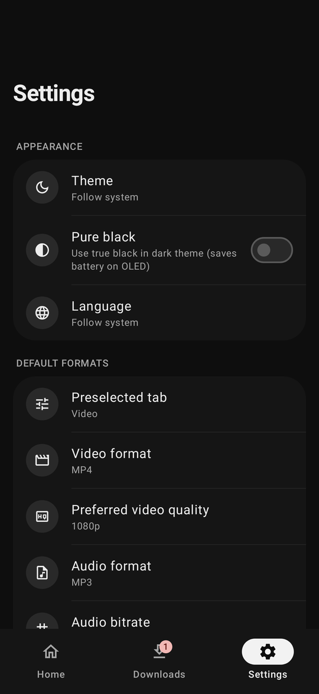

# SnapFree

A clean, monochrome Android app to download videos and audio from **YouTube**, **Instagram**, **TikTok** and
[1000+ other sites supported by yt-dlp](https://github.com/yt-dlp/yt-dlp/blob/master/supportedsites.md).
One app instead of a different downloader for every site.

> 🇧🇷 [Leia em português](#português)

| Home | Downloads | Settings |
|:---:|:---:|:---:|
|  |  |  |
|  |  |  |

<sub>Screenshots use sample data.</sub>

## Features

- **Paste or share**: paste a link, or share it straight from the YouTube / Instagram / TikTok app to SnapFree.
- **No analyze button**: complete links (YouTube watch/youtu.be/shorts/live, Instagram posts/reels/stories,
  TikTok videos and short links, or any other site) are detected while you type or paste and analyzed
  automatically. Recent results are cached, and a new link cancels the one in flight.
- **Preview** with thumbnail, title, author and duration, with the download button right under it.
- **Video**: MP4, WEBM or MKV in any quality the source offers (up to 4K/8K), with estimated size.
- **Audio**: MP3, M4A, OPUS, FLAC, WAV or the original stream, with selectable bitrate.
- **Formats**: pick any raw format the source exposes (video-only formats get the best audio merged in).
- **Background queue** (WorkManager) with progress notifications, cancel and retry.
- **History** with open, share, remove and delete-file actions.
- **Themes**: light, dark or system, optional pure black for OLED, rounded Material 3 UI with animations.
- **Languages**: English and Brazilian Portuguese, with a per-app language selector.
- **Accounts**: optional in-app login for Instagram, YouTube and TikTok. The login runs in a WebView and
  SnapFree only keeps the session cookies to pass them to yt-dlp.
- **Technical settings**: default formats and quality, save location and subfolder, simultaneous downloads,
  parallel fragments, Wi-Fi only, embed metadata/thumbnail/subtitles, SponsorBlock, proxy, speed limit,
  user agent, extra yt-dlp arguments, yt-dlp updates (stable/nightly) and automatic updates.

## Tech stack

Kotlin, Jetpack Compose (Material 3), Navigation Compose, WorkManager, Room, DataStore, Coil and
[youtubedl-android](https://github.com/JunkFood02/youtubedl-android) (yt-dlp + Python + FFmpeg packaged for Android).

```
app/src/main/java/com/snapfree/app/
├── engine/    yt-dlp wrapper: init, metadata extraction, command building, updates, retries
├── download/  download worker, concurrency gate, notifications, MediaStore saver
├── data/      Room database (downloads/history), DataStore settings, cookies
├── ui/        Compose screens (home, downloads, settings, login) and the monochrome theme
└── util/      link detection and URL cleanup
```

## Building

Requirements: **JDK 17+** and **Android SDK 35** (Android Studio Ladybug or newer includes both).
The app runs on **Android 10 (API 29) or newer**.

### Debug build

```bash
./gradlew assembleDebug
```

Or in Android Studio: **Build › Build App Bundle(s) / APK(s) › Build APK(s)**.
APKs are written to `app/build/outputs/apk/debug/`. The debug app uses the package `com.snapfree.app.debug`,
so it can be installed side by side with a release build.

### Release build

Release builds are signed with your own key, which is never part of the repository.

1. Create a keystore once (keep it and its password safe, you need the same key for every update):
   ```bash
   keytool -genkeypair -v -keystore snapfree-release.jks -storetype PKCS12 \
     -alias snapfree -keyalg RSA -keysize 4096 -validity 10000
   ```
2. Create a `keystore.properties` file in the project root (do **not** commit it):
   ```properties
   storeFile=/absolute/path/to/snapfree-release.jks
   storePassword=...
   keyAlias=snapfree
   keyPassword=...
   ```
   Instead of the file you can set the environment variables `SNAPFREE_STORE_FILE`,
   `SNAPFREE_STORE_PASSWORD`, `SNAPFREE_KEY_ALIAS` and `SNAPFREE_KEY_PASSWORD` (handy for CI).
3. Build:
   ```bash
   ./gradlew assembleRelease
   ```
   APKs are written to `app/build/outputs/apk/release/`. Without a release key, the release build falls back
   to your local debug key so it still installs.

### GitHub Actions

`.github/workflows/build.yml` builds the debug APKs on every push. Download them from the run's
**Artifacts** section.

### Which APK to install

Each build produces one APK per CPU architecture plus a universal one:

| File | Use for |
|---|---|
| `app-arm64-v8a-*.apk` | Almost every phone from the last ~8 years (recommended, smallest) |
| `app-armeabi-v7a-*.apk` | Old 32-bit phones |
| `app-x86_64-*.apk` | Android emulator |
| `app-universal-*.apk` | Works everywhere, largest |

The first launch takes a few seconds while the bundled Python and yt-dlp are unpacked.

## Tips

- yt-dlp updates itself regularly and right after a failed download (**Settings › yt-dlp engine**).
  Switch to the **Nightly** channel when YouTube breaks: fixes arrive there first.
- **Instagram** blocks most downloads without an account, even for public reels. Log in once in
  **Settings › Accounts › Instagram** (or tap "Log in to Instagram" on the error card).
- **YouTube**: when YouTube answers 403 or asks for a bot check, SnapFree updates yt-dlp, clears the player
  cache and retries with other player clients automatically. Logging in is optional.
- Tracking parameters such as YouTube `si=` or Instagram `igsh=` are removed from shared links.
- A Netscape `cookies.txt` can also be pasted manually in **Settings › Network and accounts**.

## Disclaimer

SnapFree is a personal project, built for personal use. It is not affiliated with YouTube, Instagram,
TikTok or any other site. Downloading content may violate a site's terms of service: only download content
you own or have permission to save, and respect the rights of creators.

---

## Português

App Android monocromático para baixar vídeos e áudios do **YouTube**, **Instagram**, **TikTok** e de
mais de 1000 sites suportados pelo yt-dlp, tudo em um só lugar.

**Principais recursos**

- Cole o link ou compartilhe direto do app do YouTube, Instagram ou TikTok. O link é detectado e analisado
  sozinho, sem botão de analisar.
- Vídeo em MP4, WEBM ou MKV na qualidade que a fonte oferecer (até 4K/8K), com tamanho estimado.
- Áudio em MP3, M4A, OPUS, FLAC, WAV ou original, com bitrate ajustável, ou escolha qualquer formato bruto.
- Fila em segundo plano com notificações, cancelar e tentar de novo, e histórico com abrir, compartilhar e apagar.
- Tema claro, escuro ou do sistema, preto puro para OLED, interface arredondada com animações.
- Inglês e português do Brasil, login opcional no Instagram, YouTube e TikTok, e várias configurações técnicas.

**Como compilar**

- Debug: `./gradlew assembleDebug` (ou **Build › Build APK(s)** no Android Studio).
- Release: crie sua keystore com o comando `keytool` da seção [Release build](#release-build), crie o arquivo
  `keystore.properties` na raiz do projeto (sem enviá-lo para o GitHub) e rode `./gradlew assembleRelease`.
- Instale o `app-arm64-v8a-*.apk` na maioria dos celulares. Requer Android 10 ou mais novo.

**Aviso**: projeto pessoal, para uso pessoal. Não tem relação com YouTube, Instagram ou TikTok. Baixe apenas
conteúdo seu ou que você tenha permissão para salvar.
